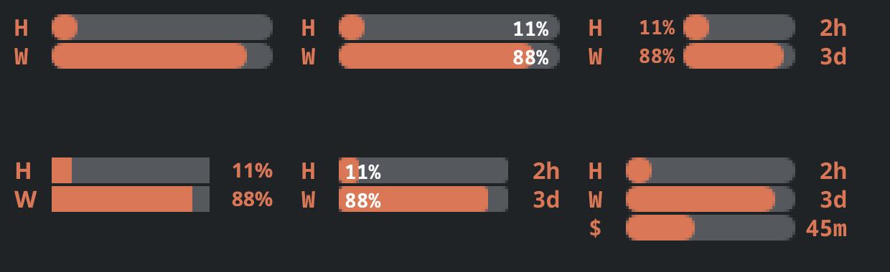
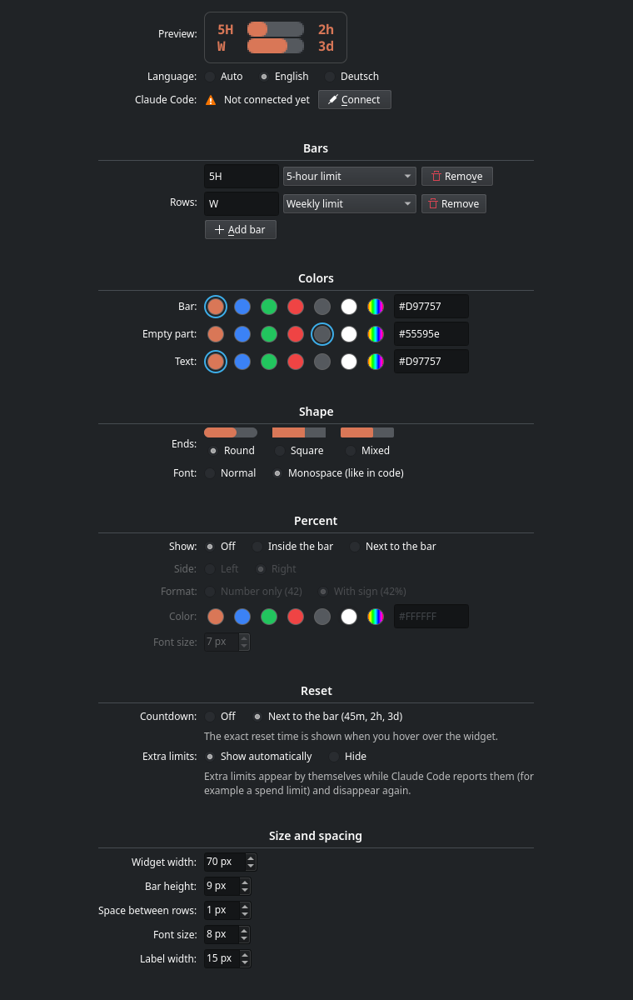

# Claude Usage Bars

A small KDE Plasma 6 panel widget that shows your **Claude Code usage limits** as bars: the 5-hour limit and the weekly limit, with the percentage and a countdown to the next reset if you want them.

> **Unofficial.** This project is not made by, affiliated with, or endorsed by Anthropic. "Claude" is a trademark of Anthropic.



## Features

- One bar per limit, stacked like Plasma's disk usage widget
- Percentage inside the bar or next to it, with or without `%`
- Countdown to the reset next to the bar (`45m`, `2h`, `3d`). Hover over the widget for the exact time.
- Bars drop to 0 by themselves when a limit resets, even while Claude Code is closed
- Extra limits (for example a spend limit) show up on their own while Claude Code reports them, and disappear again
- Colors with a palette and a color picker, round, square or mixed bar ends, monospace font, sizes and spacing
- English and German (follows the system language, or pick one)
- Fully offline: no network access, no login data. It only reads what Claude Code already gives to status lines.



## Requirements

- KDE Plasma 6
- [Claude Code](https://docs.claude.com/en/docs/claude-code) signed in with a Claude.ai subscription (Pro or Max). Claude Code only reports usage limits for subscriptions, not for API keys.
- `python3`

## Install

**From the KDE Store:** right-click the panel → *Add or Manage Widgets* → *Get New Widgets* → *Download New Plasma Widgets* → search for "Claude Usage Bars". Then add it to the panel, open its settings and click **Connect** next to "Claude Code".

**From this repository:**

```bash
git clone https://github.com/mat-53/claude-usage-bars.git
cd claude-usage-bars
./install.sh
```

Then right-click the panel → *Add or Manage Widgets* → search for "Claude Usage Bars".

The bars fill in after Claude Code's next reply.

## How it works

Claude Code can run a *status line* command and passes it the session data as JSON, including `rate_limits` (used percentage and reset time of each window). **Connect** (or `install.sh`) does two things:

1. copies a small helper to `~/.local/bin/claude-usage-bars-statusline`
2. sets it as the `statusLine` command in `~/.claude/settings.json` (a backup is saved as `settings.json.bak-claude-usage-bars`)

The helper writes the limits to `~/.local/state/claude-limits.json`, and the widget reads that file every 30 seconds. The helper prints nothing, so no status line appears in Claude Code.

**Already have a status line?** It keeps working: the helper runs first and then passes everything on to your command. **Disconnect** (or `uninstall.sh`) puts your old status line back.

### Why is there no bar for model-specific limits?

`/usage` in Claude Code can show more limits, for example a weekly limit for a single model. Claude Code does not pass those to status lines. It only sends the 5-hour limit, the weekly limit and, behind a gateway, a spend limit. The widget therefore cannot show them. If Claude Code starts reporting more limits, they appear automatically (setting *Extra limits*).

## Uninstall

```bash
./uninstall.sh
```

Or click **Disconnect** in the widget settings and remove the widget from the panel.

## Development

- `package/` is the Plasma package (`contents/ui` QML, `contents/code` the helper and setup script)
- `./build.sh` builds `dist/claude-usage-bars-<version>.plasmoid`
- `/usr/bin/python3 tests/run_tests.py` runs the offscreen tests (needs your distribution's PySide6, e.g. `python3-pyside6` on Fedora, so it uses the system Qt and KDE's QML modules). `--screenshots` also renders the pictures in `screenshots/`.
- Translations live in `package/contents/ui/texte.js`. To add a language, add a table there.

## Deutsch

Ein kleines Widget für die KDE-Plasma-6-Taskleiste. Es zeigt das 5-Stunden- und das Wochenlimit von Claude Code als Balken, auf Wunsch mit Prozent und Countdown bis zum Reset. Inoffiziell, nicht von Anthropic.

Installation: über den KDE Store (siehe oben) oder mit `./install.sh`. Danach in den Einstellungen des Widgets bei "Claude Code" auf **Verbinden** klicken. Die Sprache folgt dem System oder lässt sich in den Einstellungen wählen.

## License

MIT, see [LICENSE](LICENSE).
